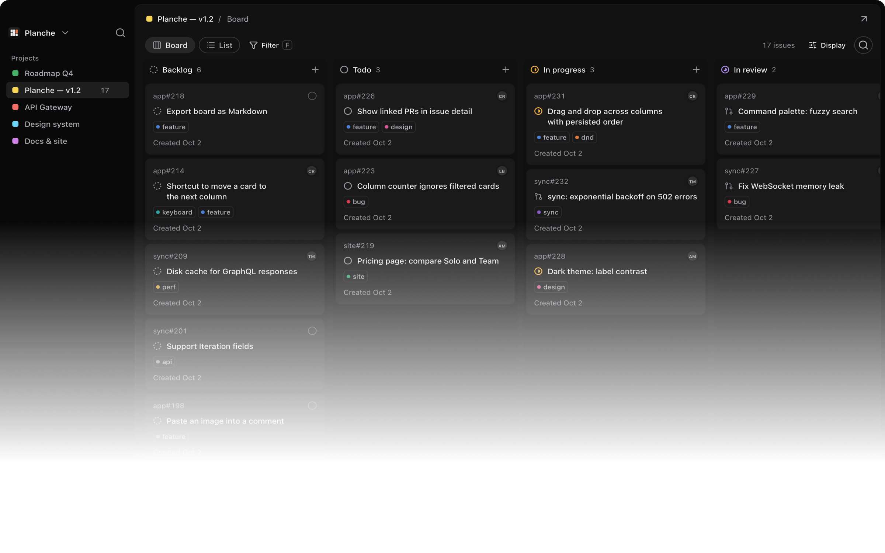

<h1 align="center">
  <picture>
    <source media="(prefers-color-scheme: dark)" srcset="app/src/assets/brand/planche-lockup-paper.svg">
    
  </picture>
</h1>

<p align="center"><strong>Your GitHub Projects, at native speed.</strong></p>
<p align="center">A macOS client for GitHub Projects.</p>

<p align="center">
  <a href="https://github.com/HorebZ/Planche/releases">Download the alpha</a> ·
  <a href="https://github.com/HorebZ/Planche">☆ Star on GitHub</a> ·
  <a href="https://github.com/HorebZ/Planche/issues/1">Roadmap</a> ·
  <a href="https://github.com/HorebZ/Planche/issues">Report an issue</a>
</p>
<p align="center">Public alpha · macOS 15 or later</p>

<p align="center">
  
</p>
<p align="center"><sub>The current app, shown with demonstration data.</sub></p>

Planche keeps your GitHub Projects board in a dedicated macOS window. Move a card,
change an assignee, or read an issue without leaving Planche. A local cache
keeps previously opened boards available when the connection drops; queued changes
sync when GitHub is reachable again.

The interface is inspired by [Linear](https://linear.app), adapted to GitHub Projects.

## Work on your board

- Switch between a board and a list, with filters for status, assignee, label and
  repository.
- Keep repository bookmarks in a separate sidebar section. Browse personal and
  organization repositories or add a GitHub URL; the selection is saved per account.
  These links currently open the repository on GitHub.
- Navigate with J and K, open the status menu with S, or use ⌘K to search the
  loaded project and run card actions. C starts a new project draft.
- Open an issue to read its Markdown description, comments and activity, inspect
  closing pull requests, and change its status or assignees. Cards also show
  available sub-issue progress and linked PR indicators.
- Post Markdown comments from the issue panel or tab with ⌘Enter. Unsent text stays
  with its account and issue; queued comments survive restarting the app. If a
  publication cannot be confirmed, check GitHub before choosing Retry.
- Keep working on cached boards offline. Descriptions and activity you've already
  loaded are saved locally too, with the activity's last refresh time.

## Alpha scope

Planche currently supports GitHub Projects v2 board views and a local list layout.
Saved GitHub view filters are not applied. Labels are read-only; Roadmap, other
project fields and creating repository issues still need GitHub.
Repository issue lists also still need GitHub.
Issue activity covers comments, closing/reopening, assignees and labels; reviews
and the full GitHub timeline still need GitHub.

The [roadmap](https://github.com/HorebZ/Planche/issues/1) tracks the next steps.
Features are described here as they become available.

## Install

Choose a DMG for your Mac's architecture from
[Releases](https://github.com/HorebZ/Planche/releases), open it, and drag Planche into
Applications. The installed app requires macOS 15 or later; it does not need Bun,
Rust or a development environment.

Planche checks for updates at startup. Use the sidebar update indicator or
**Check for updates** in Settings to install a newer alpha. Saved sessions,
preferences and cached boards survive updates; submit or discard unsent drafts
before installing.

On first launch, choose **Sign in with GitHub** and authorize the app using the
code shown. OAuth requests only `project`. Choose **Connect organizations…** to
add the GitHub App using the same GitHub account, while keeping personal projects.
The App needs read/write access to organization Projects, Issues and Pull requests,
with no Contents permission, and organization owners must approve installation.
OAuth alone can read public issues; private personal repository cards may be
redacted because `project` does not grant repository access. A classic PAT with
`repo`, `read:org` and `project` remains the full-compatibility alternative; `repo`
also permits code access. These modes never fall back to one another on refusal.
Existing broad OAuth grants must be revoked on GitHub before reduced-scope sign-in.

Use **Add account…** in the account menu or Settings to save another GitHub account.
Switch between saved accounts without signing out; both screens show each account's
PAT or OAuth connection. Credentials stay in macOS Keychain, and pending actions
remain tied to the account that created them. **Sign out** removes only the active
account and switches to another saved account when available.

The alpha is not notarized. If macOS blocks the downloaded app after the first
launch attempt, approval may be available in **System Settings → Privacy &
Security → Open Anyway**. Managed Macs can prohibit this exception.

## Local data

Your board cache lives in
`~/Library/Application Support/dev.planche.app/`. Preferences are saved locally by
the interface. These stay outside the application bundle and survive app updates.
The token is stored encrypted in the classic macOS login Keychain, without iCloud
synchronization or Touch ID. This needs no paid Apple Developer membership. macOS
may ask you to unlock the Keychain and authorize access, including when using the
CLI. Development and alpha builds reuse a free local signing identity so rebuilds
can retain **Always Allow** authorization. Planche reads it once per process and keeps it in Rust memory for
that session. Existing `auth/token` files are migrated and removed only after a
Keychain read verifies the copy. Signing out removes the saved token and leaves
the board cache on disk.

## Develop and contribute

For local development, install [Bun](https://bun.sh) 1.3 or later,
[Rust](https://rustup.rs) stable, and the Xcode Command Line Tools
(`xcode-select --install`).

```sh
git clone https://github.com/HorebZ/Planche.git
cd Planche
bun install
cp .env.example .env
chmod 600 .env
```

Set the public `PLANCHE_GITHUB_CLIENT_ID` for the primary OAuth App with Device Flow.
Optionally add `PLANCHE_GITHUB_APP_CLIENT_ID` for the companion GitHub App used to
connect organizations. A classic PAT in `PLANCHE_TOKEN` selects token mode for
local testing. See the development guide for permissions and installation.
Then run:

```sh
bun run setup:signing
bun run dev
```

Never put credentials in a `VITE_` variable. The
[development guide](docs/development.md) covers OAuth setup, the CLI, tests and
release builds. [`AGENTS.md`](AGENTS.md) describes the architecture and contribution
conventions. Run `bun run check` before pushing a change.

For a bug report, include what you expected, what happened, your macOS version
and the steps to reproduce it. For a larger change, start with the related roadmap
issue so the scope is clear before implementation.

## Inside the app

The Tauri shell and React interface sit on `planche-core`, a Rust library that
owns the GitHub client, SQLite cache and synchronization. The CLI uses the same
core. Network access and stored credentials stay out of the webview.

The public site lives in [`website/`](website/). Open `website/index.html` directly,
or run `bun run dev:website` for an HTTP preview at http://localhost:1421. The preview
command uses Python 3's standard server; the site itself has no build step or
server runtime requirement.
